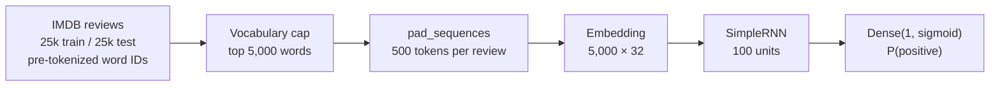

# RNN Sentiment Classification (IMDB)

[](https://colab.research.google.com/github/MannySan2004/RNN-Classification/blob/main/rnn_classification.ipynb)

A recurrent neural network that classifies IMDB movie reviews as **positive or negative**. It's built with TensorFlow/Keras and reaches **77.6% test accuracy** after three epochs. The notebook is a compact, end-to-end practice run of the sequence-modeling workflow: tokenized text → padded sequences → learned word embeddings → recurrent layer → sigmoid classifier.

---

## Pipeline



| Step | Choice | Why |
| --- | --- | --- |
| Vocabulary | `num_words=5000` | Keeps the embedding table small. Rarer words map to an out-of-vocabulary index |
| Sequence length | `maxlen=500` | Uniform tensors for batching. Shorter reviews are zero-padded and longer ones truncated (Keras pads and truncates at the start by default) |
| Representation | Trainable 32-dimensional embedding | Learns dense word vectors jointly with the classifier |
| Recurrent layer | `SimpleRNN(100)` | Baseline recurrent model. `LSTM(100)` and `GRU(100)` are already in the notebook as one-line swaps |
| Output | `Dense(1, activation="sigmoid")` | Binary sentiment probability |
| Training | Adam, binary cross-entropy, 3 epochs, batch size 64 | 391 steps per epoch over 25,000 reviews |

### Model size

| Layer | Output | Parameters |
| --- | --- | --- |
| Embedding | (500, 32) | 160,000 |
| SimpleRNN | (100) | 13,300 |
| Dense | (1) | 101 |
| **Total** | | **173,401** |

The saved summary shows these layers as "unbuilt" with 0 parameters. That's a Keras 3 behavior: a `Sequential` model isn't built until it sees data, and `input_length` is deprecated. Calling `model.build((None, 500))` before `summary()` shows the counts above.

---

## Results

| Epoch | Train accuracy | Train loss | Test accuracy | Test loss |
| --- | --- | --- | --- | --- |
| 1 | 0.5437 | 0.6856 | 0.6392 | 0.6264 |
| 2 | 0.7242 | 0.5506 | 0.6744 | 0.5963 |
| 3 | 0.6743 | 0.6082 | **0.7760** | 0.4851 |

**Final evaluation:** `RNN Accuracy: 77.60%`.

### Observations

- **The training curve is noisy.** Training accuracy dipped in epoch 3 while test accuracy rose. Plain `SimpleRNN` cells struggle to carry gradient signal across 500 time steps, the vanishing-gradient problem, so training is unstable. Gated cells (LSTM or GRU) are the standard fix, and the notebook already has them ready to uncomment.
- **The test set doubles as validation data.** `validation_data=(X_test, y_test)` makes it easy to watch generalization during training. If you tune hyperparameters on those numbers, though, use a separate validation split, for example `validation_split=0.2`, so the final test score stays unbiased.

---

## Run it

The easiest way is the **Open in Colab** badge above. The dataset downloads automatically through `keras.datasets.imdb`.

To run it locally instead:

```bash
pip install tensorflow jupyter
jupyter notebook rnn_classification.ipynb
```

In the saved Colab run, each epoch took about 1.5–2.5 minutes.

## Next steps

- Compare `SimpleRNN`, `LSTM` and `GRU` on the same split.
- Add a validation split, early stopping and a learning-rate schedule.
- Try bidirectional layers or pretrained embeddings such as GloVe.

## Tech

Python · TensorFlow / Keras 3 (`Sequential`, `Embedding`, `SimpleRNN`, `Dense`) · Google Colab
